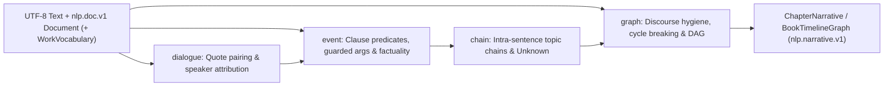

# nlp.narrative.v1

`faberline_nlp_narrative` (`crates/faberline-nlp-narrative/`) builds a source-linked narrative event, dialogue, actor
mention, and cycle-free partial-order timeline graph over `nlp.doc.v1`
(`faberline_nlp::doc::Document`) and the exact original UTF-8 text. It runs no neural model of its
own and makes no network calls.

---

## 1. Purpose & Architectural Boundary

`faberline-nlp-narrative` implements the downstream narrative layer boundary defined in
`faberline/nlp#14`:

- **Strict one-way crate dependency**: `faberline-nlp` (`nlp.doc.v1`) owns general-purpose text
  segmentation, tokenization, UPOS tagging, rule-based entities, dependency syntax, and surface
  discourse relations. `faberline-nlp-narrative` (`crates/faberline-nlp-narrative/`) depends on `faberline-nlp`
  (workspace dependency), while `faberline-nlp` does **not** depend on `faberline-nlp-narrative`.
- **Genre-neutral core, zero hardcoded work names**: Neither library code nor CLI binaries contain
  hardcoded work titles, character names, places, organizations, ranks, or genre-specific lexicons.
- **Optional caller vocabulary (`WorkVocabulary`)**: Callers may supply surface-to-canonical alias
  tables (`actors`, `places`, `objects`) and `domain_terms` matched leftmost-longest. When omitted
  (`WorkVocabulary::default()`), extraction operates purely on `nlp.doc.v1` tokens, UPOS tags,
  `EntityKind::Name` spans, and guarded dependency arcs. Caller-supplied `canonical` strings are
  opaque caller labels, not verified real-world identities.



---

## 2. Coordinate & Provenance Invariants

Every offset in `nlp.narrative.v1` inherits the exact coordinate system of `nlp.doc.v1`:

1. **Half-open Unicode scalar offsets (`Span`)**: Every `Span { start_char, end_char }`
   (`faberline_nlp::Span`) counts Unicode scalar values (`char`s) from the start of the unmodified
   chapter UTF-8 string. `start_char` is inclusive, `end_char` is exclusive, and every emitted span
   satisfies:
   ```text
   0 <= start_char <= end_char <= text_chars
   ```
   where `text_chars == text.chars().count()`. Zero-width anchors (such as an elided pro-drop
   insertion point at clause start) satisfy `start_char == end_char` within `[0, text_chars]`.
2. **Cryptographic source binding (`text_sha256`)**: Every `ChapterNarrative` records `text_chars`
   and `text_sha256` (lowercase hex SHA-256 over the exact UTF-8 input bytes) and requires
   `doc.text_chars == text_chars` and `doc.text_sha256 == text_sha256`. Any mismatch between the
   `nlp.doc.v1` document and the supplied UTF-8 text is rejected rather than silently realigned.
3. **Opaque-span non-interference**: Spans inside `doc.segmentation.opaque` (`code`, `formula`,
   `heading`, `list_item`, `citation`, `url`, `emoji`, and masked editorial boilerplate) never open
   or close quotation pairs and never emit narrative events.
4. **Chapter-qualified provenance (`LocatedSpan`)**: Graph evidence uses
   `LocatedSpan { chapter: u32, span: Span }` so both intra-chapter and cross-chapter timeline
   queries address exact `(chapter, start_char..end_char)` source intervals.

---

## 3. Core Data Model & JSON Schemas

### Schema Identifiers

| Constant | String Value | Artifact / Payload |
| --- | --- | --- |
| `NARRATIVE_SCHEMA` | `"nlp.narrative.v1"` | Specification family and single-document narrative contract |
| `CHAPTER_NARRATIVE_SCHEMA` | `"nlp.narrative.chapter.v1"` | `ChapterNarrative.schema` in per-chapter JSON outputs |
| `BOOK_RECEIPT_SCHEMA` | `"nlp.narrative.receipt.v1"` | `NarrativeManifestReceipt.schema` in `narrative_manifest_receipt.json` |

### Enum Serialization (`snake_case`)

All enums serialize in `snake_case`. `ContextZone` is internally tagged with `"zone"`; all other
enums serialize as plain JSON strings.

| Rust Enum | Serde Representation | Serialized JSON Values |
| --- | --- | --- |
| `ContextZone` | `#[serde(tag = "zone", rename_all = "snake_case")]` | `{"zone": "narrative"}`, `{"zone": "direct_quote", "quote_index": <usize>}` |
| `SpeakerBasis` | `#[serde(rename_all = "snake_case")]` | `"post_quote_speech_verb"`, `"pre_quote_speech_verb"`, `"intra_paragraph_single_actor"`, `"unknown"` |
| `Factuality` | `#[serde(rename_all = "snake_case")]` | `"actual"`, `"negated"`, `"hypothetical"`, `"modal_or_future"`, `"quoted"` |
| `EventRole` | `#[serde(rename_all = "snake_case")]` | `"agent"`, `"patient"`, `"oblique"` |
| `ArgumentBasis` | `#[serde(rename_all = "snake_case")]` | `"direct_syntax"`, `"disposal_jiang"`, `"passive_bei"`, `"compound_merged"`, `"intra_sentence_topic_chain"`, `"pronoun_resolved"` |
| `MentionKind` | `#[serde(rename_all = "snake_case")]` | `"explicit_name"`, `"nominal_phrase"`, `"pronoun"`, `"zero_pronoun_pro_drop"` |
| `EdgeKind` | `#[serde(rename_all = "snake_case")]` | `"before"`, `"simultaneous"`, `"cause"`, `"contrast"`, `"condition"` |
| `EdgeEvidenceKind` | `#[serde(rename_all = "snake_case")]` | `"explicit_discourse_relation"`, `"temporal_anchor_shift"`, `"causal_connector"`, `"intra_sentence_clause_flow"` |
| `EdgeStatus` | `#[serde(rename_all = "snake_case")]` | `"supported"`, `"non_chronological_factuality"`, `"conflict_cycle"` |
| `ChronologyOrder` | `#[serde(rename_all = "snake_case")]` | `"before"`, `"after"`, `"simultaneous"`, `"incomparable"` |
| `NarrativeUnknownKind` | `#[serde(rename_all = "snake_case")]` | `"pro_drop_ambiguous"`, `"pronoun_ambiguous"`, `"speaker_ambiguous"`, `"predicate_low_confidence"`, `"cycle_conflict_demoted"` |

### Vocabulary Input (`WorkVocabulary`)

```json
{
  "actors": [{"surface": "林遠", "canonical": "lin_yuan"}, {"surface": "陳伯", "canonical": "chen_bo"}],
  "places": [{"surface": "青石鎮", "canonical": "qingshi_town"}],
  "objects": [{"surface": "古銅鏡", "canonical": "bronze_mirror"}],
  "domain_terms": ["石室"]
}
```

- `AliasEntry`: `{ "surface": String, "canonical": String }`.
- `actors`, `places`, `objects` (`Vec<AliasEntry>`), and `domain_terms` (`Vec<String>`) default to
  `[]` and are omitted when empty (`WorkVocabulary::default()` serializes to `{}`).

### Record Structures

#### `DialogueSpan`

- `quote_index: usize` — 0-based index in `ChapterNarrative.dialogues`.
- `span: Span` — outer span including opening and closing quotation marks.
- `content_span: Span` — inner text span strictly inside the outer quotation marks.
- `paragraph: usize` — index into `doc.segmentation.paragraphs`.
- `speech_verb: Option<Span>` — framing speech predicate span (omitted when `None`).
- `speaker_span: Option<Span>` — attributed speaker mention span in the framing clause (omitted when
  `None`).
- `speaker_canonical: Option<String>` — caller `canonical` label when resolved (omitted when `None`).
- `basis: SpeakerBasis`.

#### `CandidateEvent`, `EventArgument`, and `TemporalAnchor`

- `CandidateEvent`:
  - `event_id: String` — deterministic chapter-scoped ID `"c{chapter:04}-e{idx:04}"`.
  - `chapter: u32`, `paragraph: usize`, `sentence: usize`, `clause: usize` — 1-based chapter number
    and 0-based indices into `doc.segmentation`.
  - `clause_span: Span` — span of the hosting clause.
  - `predicate_token: usize`, `predicate_span: Span` — index in `doc.tokens` and character span of
    the event predicate.
  - `zone: ContextZone` — `narrative` or `direct_quote`.
  - `factuality: Factuality` — `actual`, `negated`, `hypothetical`, `modal_or_future`, or `quoted`.
  - `factuality_cue: Option<Span>` — lexical cue triggering a non-`actual` narrative classification
    (omitted when `None`).
  - `arguments: Vec<EventArgument>`.
  - `temporal_anchors: Vec<TemporalAnchor>` — clause/sentence temporal entities from `doc.entities`
    outside `DirectQuote` (omitted when empty).
- `EventArgument`:
  - `role: EventRole`, `span: Span`, `basis: ArgumentBasis`, `score_milli: u16` (confidence in
    `[0, 1000]`, matching `SyntaxToken.score.milli()` when syntax-backed).
  - `token: Option<usize>` (index in `doc.tokens`, omitted when `None`).
  - `canonical: Option<String>` (omitted when `None`).
- `TemporalAnchor`:
  - `entity_index: usize` (index in `doc.entities`), `kind: EntityKind` (`date`, `relative_date`,
    `time`, or temporal `quantity` from `nlp.doc.v1`), `span: Span`, and optional `value` / `unit`
    (omitted when `None`).

#### `ActorMention`

- `chapter: u32`, `sentence: usize`, `clause: usize`, `span: Span`, `kind: MentionKind`.
- `canonical: Option<String>` (omitted when `None`).
- `resolved_antecedent: Option<Span>` — same-chapter antecedent span for resolved pronouns or
  intra-sentence zero-pronoun (`流水句`) pro-drop mentions (omitted when `None`).

#### `TimelineEdge`

- `edge_id: String` — deterministic chapter-scoped ID `"c{chapter:04}-g{idx:04}"`.
- `kind: EdgeKind`, `evidence_kind: EdgeEvidenceKind`, `status: EdgeStatus`.
- `from_event: usize`, `to_event: usize` — 0-based indices into `ChapterNarrative.events`.
- `connector_span: Option<LocatedSpan>` — explicit discourse or causal connector span (omitted when
  `None`).
- `evidence_spans: Vec<LocatedSpan>` — supporting predicate or temporal anchor spans (omitted when
  empty).
- `confidence_tier: u8` — priority tier in `1..=4` (`1` highest, `4` lowest).

#### `NarrativeUnknown`

- `kind: NarrativeUnknownKind`, `chapter: u32`, `span: Span`, `detail: String`.

#### `ChapterNarrative` (`nlp.narrative.chapter.v1`)

- `schema: String` (`"nlp.narrative.chapter.v1"`), `chapter: u32`, `title: Option<String>` (omitted
  when `None`), `text_chars: usize`, `text_sha256: String`.
- `dialogues: Vec<DialogueSpan>`, `events: Vec<CandidateEvent>`, `mentions: Vec<ActorMention>`,
  `edges: Vec<TimelineEdge>`.
- `event_dag_layers: Vec<Option<u32>>` — length equals `events.len()`. `Some(depth)` (`0, 1, ...`)
  for `Narrative + Actual` events; `None` (`null` in JSON) for `DirectQuote` or non-`Actual` events.
- `conflict_cycles_broken: usize` — count of chronological edges demoted to `conflict_cycle`.
- `unknown: Vec<NarrativeUnknown>` (omitted when empty).

#### `NarrativeManifestReceipt` (`nlp.narrative.receipt.v1`)

Written to `<out_dir>/narrative_manifest_receipt.json` by `nlp_narrative_batch`:

- `schema`: `"nlp.narrative.receipt.v1"`.
- Provenance & execution metadata: input `analysis_dir` / `bundles_dir` mode, `workers`,
  `vocab_sha256` (optional), `total_chapters`, `resumed_chapters`, `processed_chapters`,
  `total_chars`, and `elapsed_secs`.
- Corpus structural rollups: `total_dialogues`, `total_events`, `actual_narrative_events`,
  `total_mentions`, `total_edges`, `supported_edges`, `non_chronological_edges`,
  `conflict_cycles_broken`, `residual_dag_cycles` (invariant: `0`), and `unknown_by_kind` counts.
- Stream integrity hashes: lowercase hex SHA-256 digests over `chapters/*.json`,
  `events_stream.jsonl`, `timeline_edges.jsonl`, and `actor_mentions.jsonl`.

### Synthetic `ChapterNarrative` Example

Input UTF-8 text (`30` scalar values):

```text
林遠推開木門，將古銅鏡放入木匣。陳伯低聲說道：「明日動身。」
```

```json
{
  "schema": "nlp.narrative.chapter.v1",
  "chapter": 1,
  "title": "Chapter 1",
  "text_chars": 30,
  "text_sha256": "4cce6f05a7ad431a36fd70227ea74ab9f50ab39b55fc24132858b9457856ef2e",
  "dialogues": [
    {
      "quote_index": 0,
      "span": {"start_char": 23, "end_char": 30},
      "content_span": {"start_char": 24, "end_char": 29},
      "paragraph": 0,
      "speech_verb": {"start_char": 20, "end_char": 22},
      "speaker_span": {"start_char": 16, "end_char": 18},
      "speaker_canonical": "chen_bo",
      "basis": "pre_quote_speech_verb"
    }
  ],
  "events": [
    {
      "event_id": "c0001-e0000",
      "chapter": 1,
      "paragraph": 0,
      "sentence": 0,
      "clause": 0,
      "clause_span": {"start_char": 0, "end_char": 6},
      "predicate_token": 1,
      "predicate_span": {"start_char": 2, "end_char": 4},
      "zone": {"zone": "narrative"},
      "factuality": "actual",
      "arguments": [
        {
          "role": "agent",
          "span": {"start_char": 0, "end_char": 2},
          "token": 0,
          "canonical": "lin_yuan",
          "basis": "direct_syntax",
          "score_milli": 962
        },
        {
          "role": "patient",
          "span": {"start_char": 4, "end_char": 6},
          "token": 2,
          "basis": "direct_syntax",
          "score_milli": 941
        }
      ]
    },
    {
      "event_id": "c0001-e0001",
      "chapter": 1,
      "paragraph": 0,
      "sentence": 0,
      "clause": 1,
      "clause_span": {"start_char": 7, "end_char": 16},
      "predicate_token": 6,
      "predicate_span": {"start_char": 11, "end_char": 13},
      "zone": {"zone": "narrative"},
      "factuality": "actual",
      "arguments": [
        {
          "role": "agent",
          "span": {"start_char": 0, "end_char": 2},
          "token": 0,
          "canonical": "lin_yuan",
          "basis": "intra_sentence_topic_chain",
          "score_milli": 962
        },
        {
          "role": "patient",
          "span": {"start_char": 8, "end_char": 11},
          "token": 5,
          "canonical": "bronze_mirror",
          "basis": "disposal_jiang",
          "score_milli": 918
        },
        {
          "role": "oblique",
          "span": {"start_char": 13, "end_char": 15},
          "token": 7,
          "basis": "direct_syntax",
          "score_milli": 884
        }
      ]
    },
    {
      "event_id": "c0001-e0002",
      "chapter": 1,
      "paragraph": 0,
      "sentence": 1,
      "clause": 2,
      "clause_span": {"start_char": 16, "end_char": 22},
      "predicate_token": 11,
      "predicate_span": {"start_char": 20, "end_char": 22},
      "zone": {"zone": "narrative"},
      "factuality": "actual",
      "arguments": [
        {
          "role": "agent",
          "span": {"start_char": 16, "end_char": 18},
          "token": 9,
          "canonical": "chen_bo",
          "basis": "direct_syntax",
          "score_milli": 955
        }
      ]
    },
    {
      "event_id": "c0001-e0003",
      "chapter": 1,
      "paragraph": 0,
      "sentence": 1,
      "clause": 3,
      "clause_span": {"start_char": 23, "end_char": 30},
      "predicate_token": 15,
      "predicate_span": {"start_char": 26, "end_char": 28},
      "zone": {"zone": "direct_quote", "quote_index": 0},
      "factuality": "quoted",
      "arguments": []
    }
  ],
  "mentions": [
    {
      "chapter": 1,
      "sentence": 0,
      "clause": 0,
      "span": {"start_char": 0, "end_char": 2},
      "kind": "explicit_name",
      "canonical": "lin_yuan"
    },
    {
      "chapter": 1,
      "sentence": 0,
      "clause": 1,
      "span": {"start_char": 7, "end_char": 7},
      "kind": "zero_pronoun_pro_drop",
      "canonical": "lin_yuan",
      "resolved_antecedent": {"start_char": 0, "end_char": 2}
    },
    {
      "chapter": 1,
      "sentence": 1,
      "clause": 2,
      "span": {"start_char": 16, "end_char": 18},
      "kind": "explicit_name",
      "canonical": "chen_bo"
    }
  ],
  "edges": [
    {
      "edge_id": "c0001-g0000",
      "kind": "before",
      "evidence_kind": "intra_sentence_clause_flow",
      "status": "supported",
      "from_event": 0,
      "to_event": 1,
      "evidence_spans": [
        {"chapter": 1, "span": {"start_char": 2, "end_char": 4}},
        {"chapter": 1, "span": {"start_char": 11, "end_char": 13}}
      ],
      "confidence_tier": 4
    }
  ],
  "event_dag_layers": [0, 1, 0, null],
  "conflict_cycles_broken": 0
}
```

---

## 4. Layer-2 Consumer Guardrails over `nlp.doc.v1`

`nlp.doc.v1` decodes one spanning dependency tree per sentence and extracts surface discourse
connectors by rules. Before committing to narrative event roles or timeline edges,
`faberline-nlp-narrative` enforces deterministic Layer-2 consumer guardrails:

### Predicate Selection

- Candidate predicates require `matches!(tok.upos, Some(Upos::Verb | Upos::Adj))` inside non-opaque
  clauses.
- Adverbial and connector pseudo-predicates (`幾乎`, `紛紛`, `接著`, `隨即`, `隨後`, `同時`, `還`,
  `才`, `就`, `都`, `也`, `只`, `更`, `卻`, `却`, `居然`, `竟然`, `果然`, `頓時`, `立刻`) are
  excluded from anchoring events.
- Prenominal relative-clause modifiers (`[...的] + Noun` where the verb attaches via `deprel == "acl"`
  to a head noun in the same clause) are skipped whenever the clause has a matrix predicate.
- When `doc.syntax` is empty (rule-only `nlp.doc.v1` mode without `--models`), predicate selection
  falls back cleanly to clause-local `Verb`/`Adj` tokens without fabricating syntax scores.
- When a clause's candidate head token is suppressed by `low_confidence` UPOS/syntax diagnostics in
  `doc.unknown`, extraction abstains and records `NarrativeUnknownKind::PredicateLowConfidence`.

### Intra-Clause Core-Argument Syntax Gate

In multi-clause Chinese sentences (`流水句`), sentence-level dependency decoding can attach a topic
or object across a comma boundary or onto an adverbial proxy. When `doc.syntax` is present, core
nominal arguments (`Agent`, `Patient`, `Oblique`) are accepted from dependency arcs only when all
four conditions hold:

1. **Intra-clause locality**: `tok_clause == head_clause` (cross-clause core-argument arcs are
   rejected; cross-clause subject sharing is handled exclusively by `chain.rs`).
2. **Confidence floor**: `arc.score.milli() >= 350` (`score >= 0.35`).
3. **Predicative head**: `matches!(head.upos, Some(Upos::Verb | Upos::Adj))` and the head surface is
   not in the adverb-proxy stoplist `{還, 才, 就, 都, 也, 只, 更, 卻, 却}`.
4. **Nominal dependent**: `matches!(dep.upos, Some(Upos::Noun | Upos::Propn | Upos::Pron))`.

**Compound & double-`nsubj` deduplication**: Contiguous nominal modifier+head sequences attached to
the same predicate merge into one argument span with `ArgumentBasis::CompoundMerged`. If multiple
non-contiguous `nsubj` arcs remain in the same clause after role realignment, only the closest valid
subject is retained as `Agent`.

### Chinese Disposal (`將`/`把`) and Passive (`被`/`遭`/`由`) Role Realignment

- **Disposal (`ArgumentBasis::DisposalJiang`)**: When coverb `將`, `将`, or `把` precedes the
  clause predicate (e.g., `蘇晴將玉佩交給守衛`), the nominal span between the coverb and the
  predicate—whether parsed as `obl`, `obj`, or pre-verbal `nsubj` with no post-verbal `obj`—is
  realigned to `EventRole::Patient` (`ArgumentBasis::DisposalJiang`), while any pre-coverb subject
  remains `EventRole::Agent`. Disposal `將 + NP + V` is explicitly distinguished from future modal
  `將 + V` / `將要`, preserving `Factuality::Actual`.
- **Passive (`ArgumentBasis::PassiveBei`)**: When passive marker `被`, `遭`, `由`, or `為…所`
  precedes the predicate (e.g., `木門被狂風吹開`), the pre-marker grammatical subject is realigned
  to `EventRole::Patient` (`ArgumentBasis::PassiveBei`), and any nominal introduced between
  `被`/`遭`/`由` and the verb becomes `EventRole::Agent` (`ArgumentBasis::PassiveBei`).

### Discourse Relation Hygiene

Before turning `doc.relations` into `TimelineEdge` records, `graph.rs` filters surface-connector
false positives and normalizes inverted causal syntax:

- **Monoclausal `S，同樣 V` false `Parallel`**: Rejects `RelationKind::Parallel` anchored on
  `同樣`/`同样` when `arg1` contains no `Verb`/`Adj` predicate event (e.g., `林遠，同樣點了點頭`,
  where `arg1` is solely a subject noun phrase before a comma).
- **Adnominal determiner `另外` false `Parallel`**: Rejects `另外` when immediately followed in
  `text` by a numeral, quantifier, or classifier (`一`, `兩`, `两`, `二`..`十`, `半`, `幾`, `几`,
  `數`, `数`, `個`, `个`, `名`, `位`, `種`, `种`, `批`, `處`, `处`, `座`, `條`, `条`, `件`, e.g.,
  `另外三名守衛守在門外`).
- **Degenerate or overlapping spans**: Rejects any relation whose trimmed `arg1` or `arg2` lacks
  lexical characters or overlaps `connector` / `correlate`.
- **Backward causal orientation**: Standard forward causal relations (`因為 A，所以 B`, `A，因此 B`)
  orient `arg1 (cause) -> arg2 (effect)`. Result-first frames (`之所以 B，是因為 A`, `B，是因為 A`,
  `B because A`, where the reason connector introduces `arg2` without a preceding `因為`/`由于` in
  `arg1`) invert edge orientation to `arg2 (cause) -> arg1 (effect)` so `A` precedes `B`.

---

## 5. Factuality Isolation & `Never Guess` Coreference Policy

### Quote Pairing & Speaker Attribution

`dialogue.rs` pairs balanced and nested quotation marks within each paragraph across `「…」`,
`『…』`, `“…”` (`U+201C..U+201D`), `‘…’` (`U+2018..U+2019`), and ASCII `"..."` outside opaque
spans. Each outer quotation produces a `DialogueSpan`:

- Clauses inside `DialogueSpan.span` receive `ContextZone::DirectQuote { quote_index }`; clauses
  outside receive `ContextZone::Narrative`.
- Speaker attribution inspects adjacent pre-quote (`陳伯低聲說道：「…」` ->
  `PreQuoteSpeechVerb`) and post-quote (`「…」陳伯低聲說道。` -> `PostQuoteSpeechVerb`) speech-verb
  clauses, or an unambiguous single actor in the paragraph (`IntraParagraphSingleActor`).
- If `>= 2` candidate actors appear in the framing clause with no syntactic subject disambiguation,
  attribution abstains: `basis` is `SpeakerBasis::Unknown`, `speaker_span` and `speaker_canonical`
  are `None`, and `NarrativeUnknownKind::SpeakerAmbiguous` is emitted.

### Factuality Classification & Chronological Gate

Every `CandidateEvent` receives one of five `Factuality` values:

1. `Quoted` — `zone` is `ContextZone::DirectQuote { .. }` (the outer framing speech verb in
   `ContextZone::Narrative`, such as `說道`, is evaluated separately and remains `Actual` unless
   itself negated or modal).
2. `Hypothetical` — governed by a conditional/protasis cue (`若`, `若是`, `倘若`, `如果`, `假如`,
   `萬一`, `一旦`, `設若`, `if`, `unless`), recorded in `factuality_cue`.
3. `Negated` — governed by a negation marker (`不`, `沒`, `沒有`, `未`, `未曾`, `並未`, `並非`,
   `莫`, `勿`, `毫無`, `never`, `not`, `didn't`, `without`), excluding lexicalized non-negated
   idioms (`不久`, `不錯`, `不由得`, `不禁`).
4. `ModalOrFuture` — governed by prospective, volitional, or epistemic modal cues (`將要`, `即將`,
   `打算`, `準備`, `欲`, `想要`, `或許`, `恐怕`, `未必`, `will`, `would`, `might`, `plan to`),
   excluding disposal coverb `將 + NP + V`.
5. `Actual` — narrator-asserted realized events in `ContextZone::Narrative`.

> [!IMPORTANT]
> **Strict Chronological Factuality Gate**: Only events with
> `zone == ContextZone::Narrative && factuality == Factuality::Actual` may anchor
> `EdgeStatus::Supported` chronological ordering or receive `Some(layer)` in `event_dag_layers`.
> Edges touching any `DirectQuote`, `Negated`, `Hypothetical`, or `ModalOrFuture` endpoint remain
> inspectable in `ChapterNarrative.edges` with `status: "non_chronological_factuality"`, receive
> `event_dag_layers[i] = null`, and always evaluate to `ChronologyOrder::Incomparable`. Temporal
> entities inside `DirectQuote` are never attached to `Narrative` events.

### Conservative Topic Chains (`流水句`) & `Never Guess` Coreference

`chain.rs` extracts `ActorMention` records (`ExplicitName`, `NominalPhrase`, `Pronoun` including
classical forms `其`, `老夫`, `在下`, `妾身`, `貧道`, `本座`, `眾人`, and `ZeroPronounProDrop`) and
applies conservative intra-sentence resolution:

- **Intra-sentence topic-chain inheritance**: Across comma-joined `Narrative + Actual` clauses in
  the **same sentence**, when an earlier clause has a single unambiguous `Agent` and no competing
  animate pivot (e.g., `林遠推開木門，走入石室，點燃油燈。`), subsequent agentless clauses inherit
  that `Agent` with `ArgumentBasis::IntraSentenceTopicChain` and emit a `ZeroPronounProDrop` mention
  pointing to `resolved_antecedent`. Propagation stops at parallel topic switches (`與此同時`,
  `同時`) or unpivoted passive (`被`) transitions.
- **Mandatory `Never Guess` abstention**: Whenever `>= 2` compatible actor candidates compete in the
  active window (same sentence or immediately preceding sentence in the same paragraph) before an
  agentless clause or a third-person pronoun (`他`, `她`, `其`, `he`, `she`), the resolver **never
  guesses**:
  - Agentless clause (`林遠與周平走入大廳，坐了下來。`) -> `Agent` is left absent and
    `NarrativeUnknownKind::ProDropAmbiguous` is emitted.
  - Ambiguous pronoun (`…他端起茶杯。`) -> `resolved_antecedent` stays `None` and
    `NarrativeUnknownKind::PronounAmbiguous` is emitted.
  - Competing framing speakers -> `speaker_span` stays `None` and
    `NarrativeUnknownKind::SpeakerAmbiguous` is emitted.

---

## 6. Cycle-Free Partial-Order Timeline DAG

### Four-Tier Chronological Evidence Hierarchy

Candidate event edges are constructed across four explicit confidence tiers (`1` = strongest,
`4` = weakest):

| Tier | `EdgeEvidenceKind` | Source Cue & Chronological Semantics |
| --- | --- | --- |
| `1` | `explicit_discourse_relation` | Hygiene-validated `doc.relations`: `Sequence` -> `Before` (`A 之後，B` / `在 B 之前，A` => `A -> B`); `Parallel` (`與此同時`, `一邊…一邊…`, `meanwhile`) -> `Simultaneous`; `Contrast` and `Condition` emit structural edges without asserting `Before` precedence. |
| `2` | `explicit_discourse_relation` / `causal_connector` | Hygiene-validated `Cause` -> `EdgeKind::Cause` oriented `cause -> effect` (including inverted `之所以 B，是因為 A` => `A -> B`). For `Supported` `Narrative + Actual` endpoints, `Cause` implies strict chronological precedence (`cause Before effect`). |
| `3` | `temporal_anchor_shift` | Adjacent `Narrative + Actual` events (intra-paragraph or consecutive narrative paragraphs) where the later event carries a forward relative temporal cue (`數日後`, `三日後`, `次日`, `翌日`, `半個時辰後`, `片刻後`, `不久後`, `數月後`, `一年後`, `three days later`, `the next morning`) -> `Before`. |
| `4` | `intra_sentence_clause_flow` | Consecutive `Narrative + Actual` clause events `(e_i, e_{i+1})` in the same sentence (`e_i.clause < e_{i+1}.clause`) with no contradicting backward/simultaneous/contrast/condition relation and no flashback cue -> `Before`. |

**Flashback (analepsis) guard**: Retrospective temporal anchors (`三年前`, `數日前`, `此前`, `當初`,
`先前`, `earlier`, `years ago`) suppress forward `TemporalAnchorShift` and `IntraSentenceClauseFlow`
`Before` edges so flashbacks are never ordered after the surrounding present-time scene.

### Equivalence Condensation & Deterministic Cycle Breaking

Chronological ordering over `Supported` (`Narrative + Actual`) edges combines cotemporal equivalence
(`EdgeKind::Simultaneous`, `u ~ v`) and strict precedence (`EdgeKind::Before | EdgeKind::Cause`,
`u < v`).

To guarantee a **100% cycle-free partial order** (`0` directed cycles), `graph.rs` processes
candidate `Supported` chronological edges in deterministic priority order
`(confidence_tier ASC, edge_index ASC)` while maintaining `Simultaneous` equivalence classes and
transitive reachability on condensed components:

1. **Strict edge `u < v`**: If `[u] == [v]` or `[v]` already reaches `[u]` (`[v] <=* [u]`), adding
   `u < v` would close a cycle. The edge is demoted to `EdgeStatus::ConflictCycle`,
   `conflict_cycles_broken` is incremented, and `NarrativeUnknownKind::CycleConflictDemoted` is
   recorded at the connector or target span.
2. **Cotemporal edge `u ~ v`**: If `[u] <* [v]` or `[v] <* [u]` already holds strictly, merging
   `[u]` and `[v]` would collapse strictly ordered events into a cycle. The `Simultaneous` edge is
   demoted to `EdgeStatus::ConflictCycle` and `CycleConflictDemoted` is recorded.

### Topological Layers & Partial-Order Queries (`ChronologyOrder`)

- **`event_dag_layers`**: Each `Narrative + Actual` event receives `Some(depth)` equal to the
  longest-path distance (`0, 1, 2, ...`) of its condensed equivalence component in the `Supported`
  DAG; events in the same `Simultaneous` component share the exact same layer. All other events
  receive `None` (`null`).
- **`ChronologyOrder`**: Querying any pair of events `(a, b)` returns:
  - `Simultaneous` — `a` and `b` are both `Narrative + Actual` and belong to the same equivalence
    component.
  - `Before` — `[a]` strictly reaches `[b]` in the condensed `Supported` DAG.
  - `After` — `[b]` strictly reaches `[a]` in the condensed `Supported` DAG.
  - `Incomparable` — neither reaches the other (for example, unlinked paragraphs, parallel subplots
    without shared temporal anchors, unanchored flashbacks, or any non-`Actual` / `DirectQuote`
    event). Unconnected branches remain `Incomparable` rather than being forced into an artificial
    total order.

---

## 7. Library API & CLI Reference

### Rust Library API (`faberline_nlp_narrative`)

- `analyze_chapter_narrative(chapter: u32, title: Option<String>, text: &str, doc: &Document, vocab: &WorkVocabulary) -> Result<ChapterNarrative>`
  Validates `doc.text_chars` and `doc.text_sha256` against `text`, runs `extract_core` (`dialogue`,
  `event`, `chain`) followed by `build_chapter_graph` (`graph`), and returns a self-contained
  `ChapterNarrative`.
- `extract_core(chapter: u32, text: &str, doc: &Document, vocab: &WorkVocabulary) -> CoreExtraction`
  Runs quote pairing, guarded candidate event extraction, and intra-sentence topic-chain / mention
  resolution.
- `build_chapter_graph(chapter: u32, text: &str, doc: &Document, events: &[CandidateEvent]) -> ChapterGraphBuild`
  Applies discourse hygiene, constructs tiered `TimelineEdge`s, breaks cycles deterministically, and
  returns `ChapterGraphBuild` (including `ChapterTimelineDag` and `event_dag_layers`).
- `ChapterTimelineDag::query_order(&self, event_a: usize, event_b: usize) -> ChronologyOrder`
  Queries intra-chapter partial order over condensed reachability (`O(1)` per BitSet/reachability
  lookup); `ChapterTimelineDag::has_cycle(&self)` is guaranteed `false`. Reconstructable from
  deserialized JSON via `build_chapter_dag_from_narrative(&ChapterNarrative) -> ChapterTimelineDag`.
- `BookTimelineGraph::from_chapters(chapters: &[ChapterNarrative]) -> Self` and
  `BookTimelineGraph::query_order(&self, a: BookEventRef, b: BookEventRef) -> ChronologyOrder`
  Queries order across `(BookEventRef { chapter, event_index })` pairs, combining intra-chapter
  condensed DAGs with cross-chapter forward narrative boundaries when consecutive chapters advance
  without flashback cues.

### Single-Document CLI (`nlp_narrative_doc`)

`nlp_narrative_doc` analyzes a single UTF-8 document from stdin (or an existing `nlp.doc.v1` JSON
paired with source text) and prints one JSON `ChapterNarrative` plus a newline:

```sh
cargo run -p faberline-nlp-narrative --bin nlp_narrative_doc -- \
  --chapter 1 --title "Chapter 1" --vocab vocab.json < chapter_0001.txt
```

- Optional `--doc-json <PATH>` consumes a precomputed `nlp.doc.v1` `Document` (verified by
  `text_sha256` against stdin) instead of running `faberline_nlp::doc::analyze_document`; when
  analyzing raw text directly, optional `--models <DIR>` and `--backend <coreml|coreml-fast|onnx>`
  enable Layer-4 syntax decoding.
- Optional `--vocab <PATH>` loads `WorkVocabulary` JSON; when omitted, `WorkVocabulary::default()`
  is used.
- On input, hash-mismatch, or model errors, prints `nlp_narrative_doc: <error>` to stderr and exits
  with status `1`.

### Resumable Corpus Batch CLI (`nlp_narrative_batch`)

`nlp_narrative_batch` consumes precomputed `nlp_novel_batch` (`nlp.doc.v1`) chapter outputs and the
original UTF-8 chapter bundles in parallel without re-running neural syntax inference:

```sh
cargo run --release -p faberline-nlp-narrative --bin nlp_narrative_batch -- \
  --analysis-dir ./analysis_out \
  --bundles-dir ./bundles \
  --out-dir ./narrative_out \
  --vocab ./vocab.json \
  --workers 8
```

#### CLI Flags

| Flag | Description |
| --- | --- |
| `--analysis-dir <DIR>` | Directory containing `nlp_novel_batch` per-chapter JSONs (`chapters/*.json`) and optional `discovered_lexicon.json`. |
| `--bundles-dir <DIR>` | Directory of original UTF-8 `.txt` bundle files sliced via each chapter's `source_file` and `source_span` and verified against `doc.text_sha256`. |
| `--out-dir <DIR>` | Output directory for per-chapter narrative JSONs, corpus JSONL streams, and receipt. |
| `--vocab <PATH>` | Optional `WorkVocabulary` JSON file (`actors`, `places`, `objects`, `domain_terms`). |
| `--workers <N>` | Number of parallel OS worker threads (defaults to available logical CPU cores). |
| `--no-resume` | Recompute all chapters from scratch instead of skipping completed chapters in `--out-dir` whose `text_sha256` and vocabulary digest match. |

#### Output Directory Layout (`--out-dir`)

- `chapters/*.json` — atomic per-chapter `ChapterNarrative` files (`schema: "nlp.narrative.chapter.v1"`).
- `events_stream.jsonl` — chapter-ordered JSON Lines stream of all `CandidateEvent` records.
- `timeline_edges.jsonl` — chapter-ordered JSON Lines stream of all `TimelineEdge` records.
- `actor_mentions.jsonl` — chapter-ordered JSON Lines stream of all `ActorMention` records.
- `narrative_manifest_receipt.json` — corpus-level provenance, structural counters, zero-cycle
  verification, and stream SHA-256 receipt (`schema: "nlp.narrative.receipt.v1"`).
