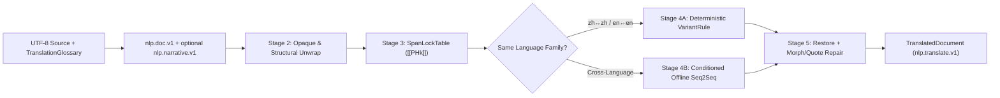

# nlp.translate.v1

`faberline_nlp_translate` (`crates/faberline-nlp-translate/`) implements deterministic variant conversion and
NLP-conditioned offline Seq2Seq translation over `nlp.doc.v1` (`faberline_nlp::doc::Document`),
the embedded first-party 4-language / 6-variant lexicon (`FNLPLX01`), and optional
`nlp.narrative.v1` (`faberline_nlp_narrative::ChapterNarrative`). It runs strictly offline with
zero network access.

---

## 1. Architectural Boundary

- **Strict one-way crate dependency**: `faberline-nlp-translate` (`crates/faberline-nlp-translate/`) depends on
  `faberline-nlp` (workspace dependency) and optionally `faberline-nlp-narrative` (workspace dependency,
  enabled by default via the `narrative` feature). Neither `faberline-nlp` nor
  `faberline-nlp-narrative` depends on `faberline-nlp-translate`.
- **Supported language variants (`TargetVariant`)**:
  - Chinese: `"zh-Hant"` (Traditional), `"zh-Hans"` (Simplified)
  - English: `"en-US"` (American), `"en-GB"` (British)
  - Japanese: `"ja"`
  - Korean: `"ko"`
- **Dual execution tracks**:
  - **Track A (`variant_rule`) — Zero-Model Deterministic Variant Conversion**: Same-family
    `zh-Hant ↔ zh-Hans` and `en-US ↔ en-GB` conversion driven by `FNLPLX01` (`lookup_zh`,
    `segment_zh`, `lookup_en`), UPOS and syntactic context disambiguation (`practice` NOUN vs
    `practise` VERB, `licence` NOUN vs `license` VERB, polysemous `發/髮`, `后/後`, `乾/幹`,
    `裡/里`, `麵/面`, `係/繫/系`), and bilateral cross-strait lexical adaptation.
  - **Track B (`neural_seq2seq`) — NLP-Conditioned Offline Seq2Seq Translation**: Cross-language
    translation backed by verified local encoder-decoder models (`nlp.models.seq2seq.v1`) on
    `tract-onnx` (`Backend::Onnx`) and macOS `objc2-core-ml` (`Backend::Coreml` CPU deterministic
    reference and `Backend::CoremlFast` Apple Silicon CPU+GPU+ANE).



---

## 2. Coordinate, Cryptographic & Opaque Invariants

1. **Bidirectional half-open Unicode scalar offsets (`Span`)**:
   - Every `source_span` indexes Unicode scalar values (`char`s) in `[0, source_chars]` over the
     unmodified input string (`source_chars == source.chars().count()`).
   - Every `target_span` indexes Unicode scalar values (`char`s) in `[0, target_chars]` over
     `TranslatedDocument.target_text` (`target_chars == target_text.chars().count()`).
   - Every paragraph, sentence, clause alignment, glossary hit, and non-omitted opaque span
     satisfies `0 <= start_char <= end_char <= *_chars`.
2. **Dual cryptographic binding**:
   - `source_sha256` and `target_sha256` record lowercase hex SHA-256 digests over the exact UTF-8
     source and rendered target bytes.
3. **Opaque protection (`OpaquePolicy`)**:
   - `verbatim_passthrough`: Fenced and inline `code`, display and inline LaTeX `formula`, `url`,
     `email`, `emoji`, and `citation` spans are bypassed/locked so their target slice is
     byte-for-byte identical to the source slice.
   - `structural_unwrap`: Markdown `#` headings, CJK/EN chapter headers (`第十二章` ↔ `Chapter 12`
     ↔ `第12章` ↔ `제12장`, `序章` ↔ `Prologue` ↔ `プロローグ` ↔ `프롤로그`), and list markers
     (`- `, `1. `, `※ `) unwrap their structural prefix, translate the inner body with inline
     opaque & glossary protection, and re-wrap cleanly.
   - `omit_editorial`: When both `mask_editorial` and `omit_masked_editorial` are enabled,
     scraper/vote editorial blocks are omitted from `target_text` and recorded with
     `target_span: null`.
4. **100% Mandatory placeholder conservation**:
   - Every inline opaque span and matched `TranslationGlossary` entry is masked as `[[PH0]]`,
     `[[PH1]]`, ... prior to neural decoding. If a model hypothesis omits or corrupts a mandatory
     placeholder, `SpanLockTable::restore` deterministically repairs it and emits
     `TranslateUnknownKind::PlaceholderRepaired`.

---

## 3. Core Schemas

### Schema Identifiers

| Constant | String Value | Payload |
| --- | --- | --- |
| `TRANSLATE_SCHEMA` | `"nlp.translate.v1"` | `TranslatedDocument.schema` |
| `TRANSLATE_GLOSSARY_SCHEMA` | `"nlp.translate.glossary.v1"` | `TranslationGlossary.schema` |
| `TRANSLATE_BATCH_RECEIPT_SCHEMA` | `"nlp.translate.receipt.v1"` | `TranslateManifestReceipt.schema` |
| `SEQ2SEQ_MANIFEST_SCHEMA` | `"nlp.models.seq2seq.v1"` | `<models>/manifest.json` |

### `TranslationGlossary` (`nlp.translate.glossary.v1`)

```json
{
  "schema": "nlp.translate.glossary.v1",
  "actors": [
    {
      "canonical": "lin_yuan",
      "surfaces": ["林淵", "阿淵"],
      "targets": { "en-US": "Lin Yuan", "ja": "リン・ユエン", "ko": "린위안" },
      "pronoun_class": "feminine_singular",
      "speech_register": "polite"
    }
  ],
  "places": [
    {
      "canonical": "qingyun_tower",
      "surfaces": ["青雲塔"],
      "targets": { "en-US": "Azure Cloud Tower", "ko": "청운탑" }
    }
  ],
  "objects": [],
  "domain_terms": []
}
```

When the `narrative` feature is enabled, `TranslationGlossary::to_work_vocabulary()` feeds actor,
place, object, and domain aliases into `analyze_chapter_narrative`, populating per-sentence
`SentenceConditioning` (`resolved_pro_drop`, `pronoun_hint`, `speaker`, `speech_register`,
`factuality`, `discourse_relation`, and `window_count`) and formatting deterministic encoder
control prefixes (`<2target> [SUBJ=...] [SPK=...] [REG=...] [FACT=...] [REL=...] `).

### Post-Decode Morphological & Typographic Repair

- **Korean (`ko`)**: Inspects the final Hangul syllable's Jongseong (`(code - 0xAC00) % 28`,
  including the Rieul `ㄹ = 8` directional exception and Sino-Korean digits) immediately after
  placeholder restoration and repairs `은/는`, `이/가`, `을/를`, `과/와`, `으로/로`, `이랑/랑`,
  and `이나/나` while propagating exact `Span` shifts.
- **English (`en-US`, `en-GB`)**: Repairs `a`/`an` phonotactics (`an hour`, `a university`,
  `an 8-core`) and sentence-initial capitalization outside protected opaque spans.
- **Quotation marks**: Localizes paired quotes (`「...『...』...」` for `zh-Hant`/`ja`,
  `“...‘...’...”` for `en-US`/`zh-Hans`/`ko`, `‘...“...”...’` for `en-GB`) without altering
  contractions (`don’t`).

---

## 4. Offline Seq2Seq Model Contract (`nlp.models.seq2seq.v1`)

`verify_seq2seq(models_dir, model_id)` enforces single-read verification over regular non-symlink
files within `<models_dir>/<dir>`, checking byte sizes, SHA-256 digests, `src_max_len` /
`tgt_max_len` caps (`<= 4096`), and special token bounds (`pad_id`, `bos_id`, `eos_id < vocab`)
before `tract-onnx` or `objc2-core-ml` parses any bytes.

- **Encoder graph** (`encoder.onnx` / `encoder.mlmodel`):
  - Input: `input_ids` (`[1, src_max_len]`, `INT64` in ONNX / `INT32` in Core ML)
  - Output: `encoder_hidden` (`[1, src_max_len, d_model]`, `FLOAT32`), zero-masked on
    `src_len..src_max_len` for strict pad invariance.
- **Decoder step graph** (`decoder_step.onnx` / `decoder_step.mlmodel`):
  - Inputs: `decoder_input_ids` (`[1, tgt_max_len]`), `encoder_hidden` (`[1, src_max_len, d_model]`)
  - Output: `logits` (`[1, tgt_max_len, vocab]`, `FLOAT32`)
- **Cross-backend receipt**: `crates/faberline-nlp-translate/tests/translate_coreml.rs` verifies `Onnx` and `Coreml`
  (`CPUOnly`) agree within `1e-4` across all 12 fixtures of `translate-test-tiny` and validates
  `docs/receipts/translate-model-runtime-<date>.json` on all platforms.

---

## 5. CLI Usage

```sh
# Single-document translation (Track A deterministic or Track B with --models)
cargo run -p faberline-nlp-translate --bin nlp_translate -- \
  --target zh-Hant --format bilingual-md < chapter.txt

# Resumable multi-worker corpus/book batch translation
cargo run -p faberline-nlp-translate --bin nlp_translate_batch -- \
  --input-dir chapters/ --output-dir out/ --target en-US \
  --glossary glossary.json --models crates/faberline-nlp-translate/models --model-id translate-test-tiny \
  --workers 4 --bilingual
```
